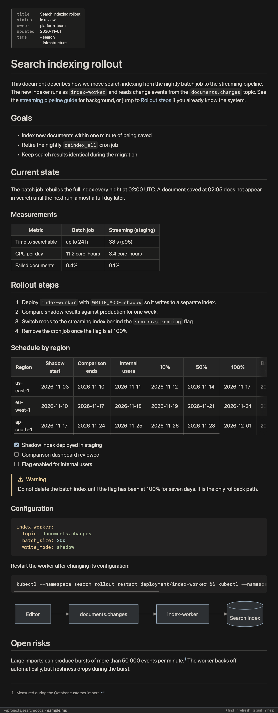
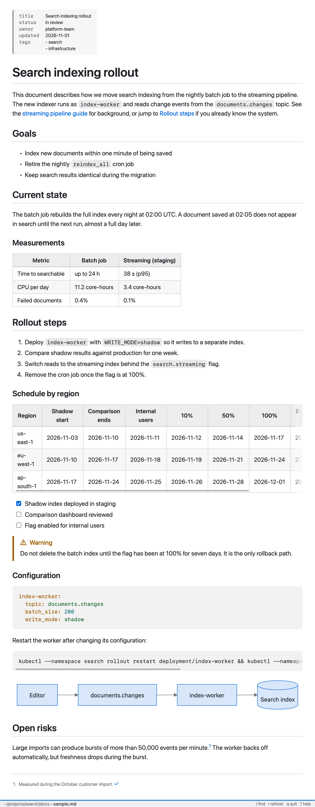
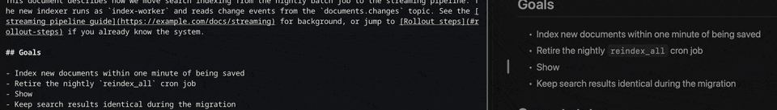
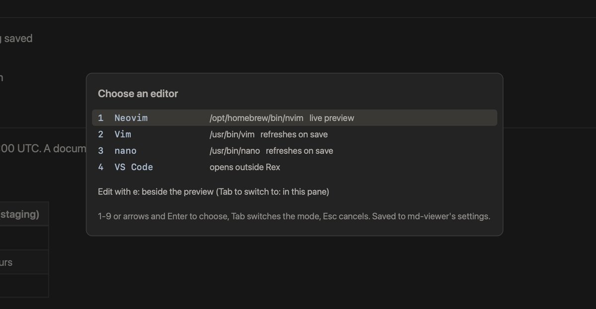
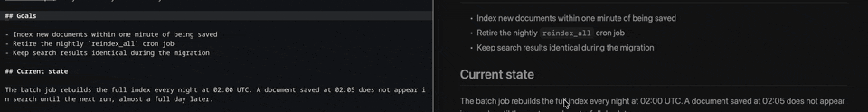
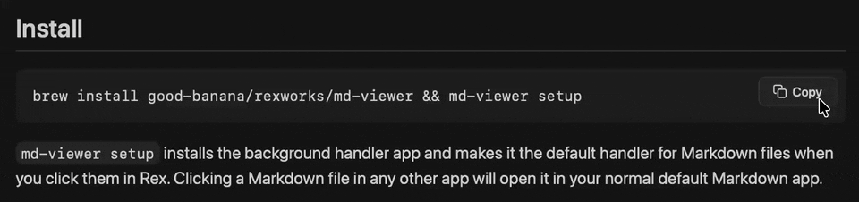

# TermDown

`termdown` lets you preview Markdown files in a dedicated pane in Rex. Click a Markdown path in any Rex pane and a rendered preview opens in a pane beside it. TermDown lays out and draws each page itself, then shows it in the terminal using the kitty graphics protocol. Its colors follow your Rex theme automatically, including when you switch themes or between light and dark.

<p>
  
  
</p>

## Features

- **Click to preview.** Click any Markdown path in any Rex pane, from `ls`, `git status`, a build log or a coding agent's reply, and the rendered page opens beside it. Click another and it opens in its own pane.
- **Real typography in the terminal.** Proportional fonts, true heading sizes, tables with header rows, syntax-highlighted code, task lists, footnotes, GitHub alerts like `[!NOTE]` and `[!WARNING]`, and frontmatter shown as a compact table.
- **Everything GitHub renders.** GitHub Flavored Markdown, the same safe HTML GitHub allows (centered logos, `<details>` sections, light and dark `<picture>` variants, side-by-side images), Mermaid diagrams, animated GIFs, SVGs and inline images.
- **A document, not a picture.** Select and copy text, copy code blocks with one click, find with `/` or Cmd-F, follow links and anchors with back and forward history, scroll wide code and tables sideways, and zoom.
- **Edit beside the preview.** Press `e` to open the file in your own editor in a pane beside the live preview, or `E` to edit in the preview's own pane. With Neovim the preview follows your cursor and shows unsaved text. TermDown never writes your Markdown file.
- **Matches your Rex theme.** Every color comes from your current Rex theme and updates when you switch themes or between light and dark.
- **Stays in sync.** The preview reloads when the file changes and keeps your place, so you can watch a plan or README update as you or an agent edits it.
- **Works with coding agents.** One command teaches Claude Code, Codex, Pi, OpenCode, the Devin CLI and cursor-agent to open the Markdown they write for you in a preview.
- **Leaves everything else alone.** Markdown files opened from Finder or any other app still open in your usual editor.

## Requirements

- macOS 14 or later
- Rex
- Xcode Command Line Tools with Swift 6 (Xcode 16 or later CLT). The formula builds from source.

## Install

```
brew tap tarvy/termdown https://github.com/tarvy/termdown
brew install termdown && termdown setup
```

The formula lives in this repository, in `HomebrewFormula/`, so the tap is the project repo itself and there is no separate tap repository. Tapping with the URL is what makes that work. If you installed an earlier version from `tarvy/tools`, run `brew uninstall termdown && brew untap tarvy/tools` first.

`termdown setup` installs the background handler app and makes it the default handler for Markdown files when you click them in Rex. Clicking a Markdown file in any other app will open it in your normal default Markdown app.

`termdown setup` also adds a Cmd-F binding to your Rex config (`~/.config/rex/init.lua`, or the file `REX_CONFIG` names). It opens TermDown's find in a preview pane and keeps Rex's normal Find everywhere else.

`termdown setup` also saves `$VISUAL` or `$EDITOR` from its environment as the `editor` setting, without asking, when no `editor` setting exists yet and the value names an executable. It prints which editor it saved and how to change it (`termdown config set editor <command>`). If neither is set, the preview asks you to choose an editor the first time you press `e`.

`termdown setup` installs a copy of the handler app, so rerun `termdown setup` after `brew upgrade termdown`.

## How it works

- A click on a Markdown path in a Rex pane opens the preview beside that pane.
- Opens from any other app are forwarded to the Markdown app you used before running `termdown setup`.

## Agents

Coding agents can open Markdown deliverables in a Rex preview pane. Run:

```
termdown agents install
```

This writes two small skills, `termdown` and `termdown-review`, into each supported agent's skills directory, only where that agent is already installed:

| Directory | Agents |
| --- | --- |
| `~/.claude/skills/` | Claude Code |
| `~/.agents/skills/` | Codex, Pi, OpenCode, Devin CLI |
| `~/.cursor/skills/` | cursor-agent |

`termdown` tells the agent to run `termdown open FILE` after it writes or substantially updates a Markdown file for you. The preview opens beside the pane focused in Rex and reuses that tab's preview.

`termdown-review` starts an interactive review of a draft and applies each pass you send. In Claude Code, `/termdown-review path/to/draft.md` starts one directly; asking to review or mark up a draft in TermDown works too. The skill holds the steps to start a review, so it doesn't depend on the agent picking the right guide, and it tells the agent not to open a browser reviewer instead.

Both skills are personal skills in your home folder, so they work in every project and directory with nothing to add per repository. A new Claude Code session picks them up, or run `/reload-skills` in one that is already open. The detailed guidance ships in the binary (`termdown agent-guide`, `termdown agent-guide review`), so upgrading TermDown updates it without rewriting the skills.

When you ask an agent to change how TermDown edits, it runs `termdown config set editor <command>` or `termdown config set edit-mode split|here` instead of editing `config.json`. Agents do not open editor panes or run `termdown edit` unless you ask. If you save a file an agent is also writing, the agent's next write is refused because the file changed, and it re-reads the file rather than overwriting your saved changes.

### Pairing agents with a preview

Each preview is an IDE that Claude Code can connect to with `/ide`: text you highlight in the preview shows up in the session, and the session can read the open file. Several Claude Code sessions can be connected to one preview, so the preview decides which of them get your highlights.

- **By default, the agent that opened the preview.** When an agent runs `termdown open`, its own session gets that preview's highlights and other sessions don't, once that session is connected. Claude Code connects when a session starts (`termdown claude`) or when you run `/ide`, so a session that was already running when the preview opened needs `/ide` and the termdown preview picked from the list. The agent tells you this next to the file path. A preview you opened yourself, by clicking a file, sends to every connected session. `termdown config set agent-pairing all` sends every preview to every connected session; `ask` asks in the preview when a second session connects.
- **Choose with `A`, or Select agent in Rex's command palette (Cmd-Shift-P).** The preview lists the connected sessions by their pane titles, plus All connected agents and Start a new agent beside this preview. Your choice lasts while the preview is open. `a` (ask the agent) and the review handoff go to the chosen session too.
- **Start a session tied to one preview:** in a Rex pane, run

  ```
  termdown claude notes.md
  ```

  It opens the preview beside the pane and starts Claude Code connected to that preview only, so you don't need `/ide`. Without a file it connects to the newest preview this pane opened. Arguments after `--` go to Claude Code, and `termdown config set agent <command>` runs something else, such as `claude --model opus`.

Claude Code pins a session to a preview through `CLAUDE_CODE_SSE_PORT`; the preview identifies each connected session from the process ID Claude Code reports and the `REX_BLOCK` in that process's environment. If a preview closes, its port goes with it: run `/ide` in the session or start it again.

To teach only some agents, name them: `termdown agents install claude cursor`. The names are `claude`, `codex` and `cursor`; `pi`, `opencode` and `devin` also pick the shared `~/.agents` directory. `remove` and `status` take the same names, and with none they cover every agent.

`termdown agents status` shows each directory as current, outdated, missing, skipped or foreign. `termdown agents remove` deletes only skills that TermDown installed. `termdown setup` lists the agents it found that don't have the current skill yet and asks once, with Enter meaning yes; when every agent it found is current, it asks nothing. `termdown uninstall` removes them.

## Editing

Press `e` in a preview to edit the file it shows, in your own editor, without leaving Rex. TermDown never writes your Markdown file; the editor does.

There are two modes:

- **Split** (the default). The editor opens in a Rex pane on the left of the preview, at 50% width, with focus. The pane is labeled `termdown-editor`.
- **Here.** The editor temporarily takes over the preview's own pane, and the preview comes back when the editor exits.

<p>
  
</p>

`e` runs the mode set by `edit-mode` (`split` unless you change it). `E` (Shift-E) runs the other mode. The editor opens at the line of the current selection, or at the line at the top of the view. `,` opens a picker listing the editors TermDown finds on your `PATH`. Tab in the picker switches the mode, and choosing an editor saves it as the `editor` setting together with the mode shown.

<p>
  
</p>

### Choosing the editor

TermDown uses the first of these that names an installed editor:

1. The `editor` setting.
2. `$VISUAL`, then `$EDITOR`, from TermDown's own environment.
3. `$VISUAL`, then `$EDITOR`, from your login shell.

If the `editor` setting names a command that cannot be found, TermDown stops there and shows a message instead of trying the others. If none of the three is set, pressing `e` opens the picker. The setting may include arguments, such as `nvim -u NONE`. TermDown recognizes the editor from the command name; set `editor-kind` to override that. `termdown config` shows which editor is in use and where it came from.

| Editor | Command names | Where it runs | Preview sync |
| --- | --- | --- | --- |
| Neovim | `nvim` | Rex pane | Live |
| Vim | `vim`, `vi`, `view` | Rex pane | Refresh on save |
| Helix | `hx`, `helix` | Rex pane | Refresh on save |
| Emacs | `emacs`, `emacsclient` | Rex pane, in a terminal | Refresh on save |
| nano | `nano` | Rex pane | Refresh on save |
| micro | `micro` | Rex pane | Refresh on save |
| Kakoune | `kak` | Rex pane | Refresh on save |
| Any other terminal editor | anything else | Rex pane | Refresh on save |
| VS Code | `code`, `code-insiders` | Outside Rex | Refresh on save |
| Cursor | `cursor` | Outside Rex | Refresh on save |
| Zed | `zed` | Outside Rex | Refresh on save |
| Sublime Text | `subl` | Outside Rex | Refresh on save |

Every editor opens at the line you were looking at.

### Neovim live sync

Live sync needs Neovim 0.9 or later. With it, the preview and the editor stay linked in both directions:

- The preview follows the editor's cursor.
- The preview shows the editor's unsaved text. If the file also changes on disk while you have unsaved edits, the preview says so and keeps showing your unsaved text.
- Clicking in the preview moves the editor's cursor to that spot.

<p>
  
</p>

TermDown writes the plugin that does this to its own support folder and loads it only into the Neovim it starts, so your own Neovim configuration is not touched. `termdown doctor` checks the installed Neovim version.

### Other editors

Helix and every other terminal editor open at the line and refresh the preview each time you save. VS Code, Cursor, Zed and Sublime Text are launched at the line and never get a pane, and never take over the preview's pane, whichever of `e` and `E` you pressed. The preview stays live and refreshes on save.

### Changes from agents and other tools

If an agent or another program changes the file while you are editing, the preview shows the change as soon as it is on disk. Neovim reloads the buffer on its own when it has no unsaved edits, and asks you what to do when it does. Other editors do their own thing. In Helix run `:reload` (or `:reload-all`) to pick up the change. Vim reloads on focus when `autoread` is set.

### Closing

When the preview closes, the editor pane stays open, because it may hold unsaved work. When the editor exits, the preview stays open, including a preview opened by `termdown edit`.

### Multiple previews

Within one Rex session there is one editor per file. Pressing `e` or `E` in any preview of a file that already has an editor focuses that editor instead of opening a second one. With Neovim, live sync follows the preview where you last pressed `e`.

## Review

Review turns a preview into a markup surface for a draft you are working on with Claude Code. You mark passages, send the marks to the agent as one pass, and the agent revises the file. The preview refreshes when the agent writes.

**Starting.** Press `m` in a preview. Review needs a connected Claude Code session to send to: one that was started with `termdown claude`, or that you connected with `/ide`. When one is connected, the status bar shows a green plug; press `A` to see which session it is. With none connected, `m` says so and review stays off; run `/ide` in the session and pick the termdown preview, or press `A` to start one beside it. A session connected from outside Rex shows the plug, but review needs one in a Rex pane, and `m` says so. With several sessions connected and none chosen, `m` opens the picker (a review goes to exactly one session, so there is no All connected agents row). Press `m` again to end review.

**Marking.** While review is on, an `IR` badge leads the status bar, followed by the file's folder and name, and the right side shows a legend of the numbered marks, how many you have made and the review keys. As the pane narrows, the labels shorten (`Del`, `Awk`, `Trim`, `Halve`, `Src?`, ...), then fewer keys show, then only the digits; the folder and file name give way first. Select text, then press `1` to `9`, or click a number in the legend. `9` is a note: a dialog opens over the page, quoting the passage, and you type the instruction for it. The note wraps across lines as you type; Enter adds it and Esc cancels. Clicks do nothing while the dialog is open, and the wheel still scrolls. The mark colors the passage. `U` removes the last mark, and `x` clears the marks inside the selection.

**Typing edits.** Press `i` to edit the draft in place while review is on: what you type is underlined faintly until you send the pass, and `Cmd-B`, `Cmd-I` and `Cmd-K` make the selection, or the word at the caret, bold, italic or a link (`Cmd-K` asks for the URL, adds `https://` when you leave the scheme off, and `Esc` cancels).

**The marks list.** `M` opens a list of every mark with its type and passage.

| Key | Action |
| --- | --- |
| Up, Down, j, k | Move through the marks |
| Enter | Select that passage and scroll to it |
| x | Delete the mark |
| 1-9 | Change the mark's type |
| n | Edit the mark's note |
| Esc, M | Close the list |

**Sending.** `s` sends the marks, and anything you typed, as one pass and ends review. Each pass stands alone: the agent applies it and carries on with the conversation, so you can keep talking to it, or press `m` to mark the revision as the next pass. Pass numbers carry on for the same draft. TermDown pastes the pass into the agent's prompt and presses Enter, but only when that pane is at an idle, empty prompt. An agent that is still working with an empty prompt gets the pass queued, as Claude Code queues any message. A pass is refused only when the agent's pane shows a dialog or holds text you have started typing there (a link on screen, such as the `[Image #1]` Claude Code shows for a pasted screenshot, does not count): then nothing is written and the bar says `Agent is busy or has unsent text: finish there, then press s again`. Review stays on with your marks, and you press `s` again when the agent is ready. If the paste does not show in the prompt, or a dialog opens just as it arrives, Enter is not pressed and the bar says the pass was written but not submitted. Review never falls back to the clipboard.

**Changes since the last pass.** `D`, with review on or off, writes what changed in the draft since the last pass you sent, with the mark that asked for each change and the marks that got no change, and shows it in a pane to the right of the preview at 40% width. On a first pass it says `No earlier pass to compare against`. Press `D` again to refresh the pane in place; it closes, and its file is removed, when the preview quits or shows another file.

**Marks you have not sent are kept.** They are saved as you make them. If the preview closes or restarts, they come back the next time review starts on that file. `m`, `q` and opening another file would drop them, so the bar asks `Discard 2 marks? y / n` first. Only one preview at a time can review a given file.

**Copying a draft for email.** `O` copies the selection, or the whole document when nothing is selected, as rich text: formatted HTML next to the plain text, so it pastes into Outlook with its bold, links, lists and tables and without the front matter. A link to another file, a path or a heading keeps its text but loses the link, since it would point nowhere in an email. It works with review on or off.

**From the agent.** Run `/termdown-review FILE` in Claude Code, or ask the agent to review the draft in TermDown. The agent runs `termdown review FILE` to start a review of a draft it wrote. It opens the preview, or reuses the one already showing the file, and turns review on. If no session is connected yet, review starts when one connects. If review is already on for that file, nothing changes and the bar says `Review is already on`. If the preview is showing a different file and you have unsent marks, you are asked before it switches.

**Own pane only.** An agent works only in the tab of its own pane (`$REX_BLOCK`, shown by `rex whoami --json`) and runs termdown from its own shell, so the preview opens beside it. `termdown review --check FILE` judges that tab alone and changes nothing. It prints `REVIEW:` (`READY`; `OPEN`, under review in a preview in this tab; `LOCKED`, under review in a preview in another tab or session; `NO_REX`; `NO_FILE`), `PREVIEW:` (`here` when a preview in this tab shows the file, `none`, or `unknown`), `CONNECTED:` (whether this pane's agent is connected to that preview through `/ide`) and the `NEXT:` step. Agents say a draft is open only after it prints `PREVIEW: here`. When `CONNECTED:` is not `yes`, the agent types `/ide` into its own prompt without sending it, so you press Enter and pick the termdown preview.

## Commands

### Setup
```
termdown setup
```
macOS may ask you to confirm the change of default app for Markdown files.

### Doctor
```
termdown doctor
```
`termdown doctor` diagnoses the installation: handler app, highlighting and diagram resource bundles, and default handler registration. It also reports the editor TermDown would use, where it came from, its kind and whether it syncs live or refreshes on save, plus the current `edit-mode`. For Neovim it checks the version and reports whether live sync is supported (0.9 or later). If the `editor` setting names a command that cannot be found, doctor reports a failure.

The handler log is at `~/Library/Application Support/termdown/handler.log`.

### View Files
```
termdown view <file>
```

### Open Files
```
termdown open <file>
```

### Config
```
termdown config
termdown config get <name>
termdown config set <name> <value>
termdown config unset <name>
```
`termdown config` shows each setting with its effective value and whether it comes from a setting, a default or detection, then how the editor resolves and which editors it found. `get` prints one value, `set` validates and saves it, and `unset` removes it. The names are `previews`, `edit-mode`, `editor`, `editor-kind`, `agent-pairing` and `agent`; see [Settings](#settings).

### Edit
```
termdown edit [--here] [--line N] <file>
```
Opens the file's preview, or reuses the one that is already open, then starts editing from it. `--here` runs the mode other than your `edit-mode`, as `E` does. `--line N` starts the editor at line N (the default is 1).

### Review
```
termdown review <file>
```
Opens the file's preview, or reuses the one that is already open, then turns review on there. It exits once the preview has the request. See [Review](#review).

### Uninstall
```
termdown uninstall && brew uninstall termdown
```
`termdown uninstall` removes the handler app, restores the previous Markdown handler and removes the Cmd-F binding from your Rex config. It also deletes TermDown's support folder, which holds the Neovim plugin, its sockets and sidecars, the editor files and your settings. macOS may ask you to confirm the change of default app for Markdown files.

## Settings

Change settings with `termdown config`, the editor picker (`,`) or `termdown setup`. Editing `~/Library/Application Support/termdown/config.json` by hand also works, but is never required.

| Name | Values | Default | Meaning |
| --- | --- | --- | --- |
| `previews` | `perFile`, `single` | `perFile` | `perFile` gives each file its own preview pane. `single` keeps one preview per tab that switches to each file you open. |
| `edit-mode` | `split`, `here` | `split` | What `e` does: edit beside the preview, or in the preview's pane. `E` does the other. |
| `editor` | a command | none | The editor to use, with any arguments. When unset, TermDown uses `$VISUAL` or `$EDITOR`. |
| `editor-kind` | `neovim`, `vim`, `helix`, `emacs`, `nano`, `micro`, `kakoune`, `vscode`, `cursor`, `zed`, `sublime`, `terminal` | detected | Overrides how TermDown treats the editor, for a wrapper script or an unusual command name. |
| `agent-pairing` | `opener`, `all`, `ask` | `opener` | Which connected Claude Code sessions get a preview's highlights: the one in the pane that opened it (every session when none is), all of them, or ask when a second connects. `A` overrides it for one preview. See [Pairing agents with a preview](#pairing-agents-with-a-preview). |
| `agent` | a command | `claude` | What `termdown claude` and Start a new agent run. |

```
termdown config set editor nvim
termdown config set edit-mode here
termdown config unset editor
```

`config set editor` fails if the command cannot be found.

## Mouse

- Wheel scrolls. Shift+wheel or a sideways swipe scrolls a wide code block or table.
- Click follows a link, opens or closes a details section, or copies a code block with its Copy button.
- With Neovim beside the preview, click also moves the editor's cursor to the spot you clicked.
- Drag selects text. Double-click selects a word, and triple-click selects a paragraph, list item or table cell.

<p>
  
</p>

## Links

- Links to other Markdown files open in the preview. Backspace goes back.
- Web and mailto links open in your browser or mail app.
- Links to local files open only when the target is an image, audio or video, a PDF, or plain text. Scripts, apps, HTML, and SVG are blocked.

## Keys

| Key | Action |
| --- | --- |
| j, Down | Scroll down |
| k, Up | Scroll up |
| d | Scroll down half a page |
| u | Scroll up half a page |
| Space, Page Down | Scroll down a page |
| b, Page Up | Scroll up a page |
| g, Home | Top |
| G, End | Bottom |
| Tab, Shift-Tab | Focus the next or previous link, details section, code block or wide table |
| h, l, Left, Right | Scroll the focused code block or table sideways |
| Enter | Follow the focused link, open or close the focused details section, or copy the focused code block |
| c | Copy the focused code block |
| Esc | Close find, then clear the selection, then clear focus |
| Backspace, h | Go back |
| L, Shift-Backspace | Go forward |
| /, Cmd-F | Find (Cmd-F works through the Rex binding that `termdown setup` installs) |
| n, N | Next or previous match |
| y, Cmd-C | Copy the selection as plain text |
| Y | Copy the selection as Markdown |
| O | Copy the selection, or the whole document when nothing is selected, as rich text for pasting into Outlook |
| Cmd-A | Select everything |
| +, -, 0 | Zoom in, zoom out, reset zoom |
| e | Edit the file in the mode set by `edit-mode` (beside the preview by default) |
| E | Edit in the other mode |
| , | Choose the editor |
| a, Cmd-L | Paste the selection into the paired agent's prompt, unsent |
| A | Choose which agent gets highlights, or start one beside the preview (also Select agent in Rex's palette) |
| m | Start or end review (needs a connected Claude Code session) |
| 1-9 | With review on, mark the selection; 9 asks for a note |
| U | Remove the last mark |
| x | Clear the marks inside the selection |
| M | List the marks: Up and Down (or j and k), Enter, x, 1-9, n, Esc or M |
| s | Send the marks to the agent as one pass and end review |
| D | Show what changed since the last pass sent, in a pane to the right |
| r | Refresh: reload the file and re-read the theme |
| ? | Show all keys and mouse actions |
| q, Ctrl-Q, Ctrl-C | Quit |

## Credits

Vendored libraries and their licenses are listed in `Sources/TermDownRender/Resources/THIRD_PARTY_NOTICES` (highlight.js) and `Sources/TermDownMermaid/Resources/mermaid/THIRD_PARTY_NOTICES` (mermaid).

## Releasing

The formula is `HomebrewFormula/termdown.rb`, in this repository. It pins a tag and the commit that tag points at, so a release takes two commits: the code, then the formula.

1. Set `termDownVersion` in `Sources/TermDownCore/Version.swift` to X.Y.Z and commit it. This is the code commit.
2. Tag that commit: `git tag termdown-vX.Y.Z`.
3. Run `scripts/release.sh X.Y.Z`. It checks that `Version.swift` and the tag agree, then writes `HomebrewFormula/termdown.rb` pinned to the tag and its commit.
4. Commit `HomebrewFormula/termdown.rb`. The tag stays on the code commit from step 1.
5. Push the commits and the tag to `tarvy/termdown`.

To test the formula before tagging, run `scripts/release.sh --local X.Y.Z`. It writes a formula pinned to `HEAD` with a `file://` URL to `$TMPDIR/termdown.rb`. That formula is for local testing only.
